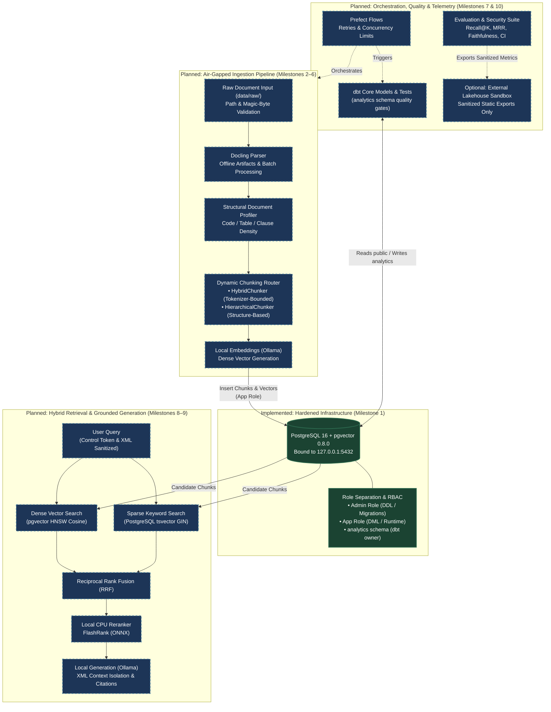

# Security-Hardened Local RAG Pipeline

A modular Retrieval-Augmented Generation (RAG) system designed for local execution with strict separation of concerns, least-privilege database access, prompt-injection defenses, and zero cloud lock-in.

---

## Architecture & Process Flowchart

The diagram below maps the end-to-end ingestion, retrieval, orchestration, and evaluation workflows—distinguishing **currently implemented infrastructure (Milestone 1)** from **planned pipeline modules (Milestones 2–10)**.



---

## Core Design Principles

1. **Least-Privilege Database Access:** Schema migrations run exclusively under the database admin role, while runtime ingestion, search, and `dbt` transformations execute under a restricted application role with zero DDL rights in `public`.
2. **Air-Gapped Runtime:** Local services bind strictly to `127.0.0.1`. Model weights and tokenizers are pre-cached locally so zero network calls leave localhost during runtime execution.
3. **Prompt & Token-Injection Defense:** Retrieved chunks are isolated inside `<untrusted_context>` XML delimiters, with closing XML tags and model control tokens stripped prior to prompt interpolation.
4. **Document-Aware Dynamic Chunking:** Documents are structurally profiled before splitting to route technical/code texts, narrative prose, and hierarchical clauses to tailored chunking strategies.
5. **Zero Cloud Lock-In:** Core application modules never import cloud SDKs. Any optional external analytics rely strictly on sanitized static file exports.

---

## Technology Stack

| Layer | Technology | Role |
| :--- | :--- | :--- |
| **Database & Search** | PostgreSQL 16 + `pgvector` (`0.8.0`) | HNSW cosine vector index + `tsvector` GIN full-text search |
| **Local LLM & Embeddings** | Ollama | Local inference and embedding generation bound to `127.0.0.1` |
| **Document Parsing** | Docling | Layout and table extraction using pre-cached local artifacts |
| **Reranking** | FlashRank | Local CPU ONNX cross-encoder reranking |
| **Orchestration & DQ** | Prefect + dbt Core | Workflow retries + automated SQL quality tests in `analytics` |
| **Backend & Validation** | Python, SQLAlchemy, Alembic, Pydantic | Type-safe domain boundaries, `SecretStr` config, `uv` environment |
| **CI & Security** | GitHub Actions, Ruff, mypy, pytest | Static analysis, security linting, CVE checks, and secret scanning |

---

## Project Structure

```text
RAG/
├── .github/workflows/ci.yml   # Linting, type checks, tests, dependency & secret scans
├── data/
│   ├── models/                # Pre-cached local model weights & tokenizers (gitignored)
│   ├── processed/             # Intermediate parsed document artifacts (gitignored)
│   └── raw/                   # Raw input documents (gitignored)
├── dbt/                       # dbt Core models & data quality tests (analytics schema)
├── flows/                     # Prefect orchestration flows
├── infra/
│   ├── docker-compose.yml     # Hardened PostgreSQL + pgvector service
│   └── init.sql               # Idempotent RBAC, schema isolation & default privileges
├── src/rag/
│   ├── cli/                   # CLI entry points
│   ├── chunking/              # Structural profiler, strategy router & chunkers
│   ├── database/              # SQLAlchemy models, connections & repositories
│   ├── embeddings/            # Local Ollama embedding client
│   ├── generation/            # Local LLM client & prompt sanitizers
│   ├── ingestion/             # Path/magic-byte validation & batch parsers
│   ├── retrieval/             # Hybrid dense/sparse search, RRF & reranker
│   ├── config.py              # Pydantic Settings with SecretStr
│   └── schemas.py             # Pydantic domain models
├── tests/                     # Unit, retrieval & adversarial security test suites
├── .env.example               # Safe environment variable template
└── pyproject.toml             # Python project & dependency configuration
```

---

## Development Roadmap

### Phase 1 — End-to-End Core RAG Slice
- [x] **Milestone 1: Hardened Infrastructure** — Pinned `pgvector/pgvector:0.8.0-pg16` bound to `127.0.0.1`, SQL-injection-safe `init.sql`, admin vs. application role separation, and `analytics` schema isolation.
- **Milestone 2: Python Foundation & CI/CD** — `uv` environment standardization, offline model pre-caching, `SecretStr` settings, strict static analysis, and GitHub Actions security CI.
- **Milestone 3: Database Schema & Migrations** — Relational + vector schema (`documents`, `chunks`, `retrieval_logs`), HNSW + GIN indexes, and Alembic migrations.
- **Milestone 4: Memory-Safe Ingestion** — Path traversal/magic-byte validation and page-batched Docling parsing.
- **Milestone 5: Document-Aware Dynamic Chunking** — Structural document profiler routing between `HybridChunker` and `HierarchicalChunker`.
- **Milestone 6: Local Embeddings** — Batched embedding ingestion with task prefixes and vector dimension validation.
- **Milestone 8: Hybrid Retrieval & Reranking** — Dense cosine + sparse keyword search merged via RRF and reranked with FlashRank.
- **Milestone 9: Grounded Generation** — Local LLM generation with XML context isolation, control-token sanitization, inline citations, and abstention thresholds.

### Phase 2 — Orchestration & Data Quality
- **Milestone 7: Prefect & dbt Core** — Wrap `src/rag/` modules in resilient Prefect flows and enforce automated `dbt test` quality gates in the `analytics` schema.

### Phase 3 — Evaluation, Demo & Telemetry
- **Milestone 10: Benchmarks, Security Suite & UI** — Golden Q&A evaluation (`Recall@K`, `MRR`, `Faithfulness`), adversarial prompt-injection tests, lightweight API/UI demo layer, and optional sanitized metric exports.

---
